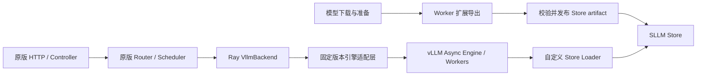

# ServerlessLLM vLLM 升级设计

本文拥有独立 ServerlessLLM 的升级目标与阶段边界；当前实现资格见
[兼容矩阵](compatibility-matrix.md)，安装、Store 格式和生命周期分别由同目录文档拥有。
目标为 vLLM 0.31.0；不向 CrossPool runtime 引入 Store、Ray 或 vLLM。

升级必须保持原版项目功能和规范，包括模型管理、存储感知调度、请求语义、迁移、
Store 与资源生命周期。原版参照为 `9f50241baa5386e06a9321c51f19a9ef5f964c2b`。
继承缺陷、新版回归和未验证能力必须分别记录；不能通过删减功能或降低验收解除阻断。
源码声明和生成接口拥有精确签名，本文不作为已经完成升级的声明。

实施及审查规则见根目录 AGENTS.md。历史方案、补丁审计及逐次实验报告保存在
仓库外的研究归档；它们不是新版本的运行资格。来源与证据入口见
[provenance.json](provenance.json) 和 [evidence-index.json](evidence-index.json)。

### 来源与环境

- 原版行为参照 SLLM 提交 `9f50241baa5386e06a9321c51f19a9ef5f964c2b`；旧 vLLM
  0.11.2 路线作为升级前接口参照。历史 candidate02 补丁不能不加区分地全部搬入
  vLLM：逐项审计，保留仍适用的修复，排除 Transformers 专用或临时实验改动。
- 新版起点固定为已测 vLLM **0.31.0**，不跟随浮动 latest。研究实测环境为
  Python 3.12、Torch 2.13.0+cu130、Transformers 5.17.0；这是候选组合的证据，
  不是完整 SLLM 新环境已准入的声明。
- 实施前用 `uv` 锁定完整 Linux 依赖，包括 Ray、Store Python 包及原生构建依赖，
  保存 wheel/镜像摘要、编译器和驱动要求。重新编译 Store 扩展；不得复用旧
  cp310 扩展或仅靠修改版本字符串解决 ABI。依赖解析和无 GPU 导入先完成，
  涉及 CUDA 初始化的检查留到获批实验。
- 不要求和 CrossPool 共用环境。SLLM 的 Torch CUDA 13.0 实测不自动证明
  CrossPool CUDA 13.2 工具链已满足，也不证明旧 V100 可以运行新版 SLLM 候选。

## 方案选择与行为边界

| 接法 | 取舍 | 本设计选择 |
| --- | --- | --- |
| 更新 SLLM 整体依赖，Ray backend 内使用新版异步引擎及其原生子进程 | 复用控制面及请求调用链；需回归 Ray/Store/ABI | 默认方案 |
| 旧 host 与新版引擎分环境，通过额外服务桥接 | 增加通信、部署和关闭责任；当前无保留旧环境的要求 | 不作为默认实现 |
| 将独立 `vllm serve` 当 HTTP 黑盒 | 普通生成容易，但原有 token 跟踪、恢复和排空接口不能直接保留 | 不采用 |

“整体依赖升级”不意味着把所有组件放进单个进程：保持 SLLM 原有 Ray actor 边界，
vLLM 仍管理其 EngineCore/Worker 子进程。默认先验证同节点的 multiprocessing
执行器，避免嵌套 Ray GPU 调度；TP rank 全部绑定该 backend 实际分配到的设备。
不能用额外进程绕过 Ray 配额。若该执行器无法满足原版某个已支持拓扑，将其记为
兼容阻断并评审修订，不静默更换系统架构。

必须保留模型注册/删除、存储感知放置、按需加载、扩缩容、路由、请求计数及原有
迁移开关的配置含义。模型加载仍经 SLLM Store；不能用原生 HF 加载绕过 Store
来宣称接入完成。默认值必须显式冻结，防止新版引擎默认开启能力而改变实验设置。

升级中不自动改变 messages 到 prompt 的原版规则，不静默加入 chat template、
thinking 或采样默认值。原版简易拼接规则即使不理想，也须先建立兼容用例；
共同性能评测可在驱动侧冻结渲染后的文本/token IDs，另验两侧实际输入一致。
HTTP 仍按原版非流式行为验收；真实流式观测作为后续独立扩展，不能阻塞普通服务
兼容，也不能以完整响应延迟填充 TTFT。

## 目标结构与改造范围

以下路径指独立 SLLM 工程，不是 CrossPool 中拟新增的生产模块。

| 模块 | 目标改造 |
| --- | --- |
| `sllm/backends/vllm_backend.py` | 保留 SllmBackend 方法与响应协议；替换失效导入、配置与关闭入口；补齐并发及异常清理 |
| 新增后端版本适配模块 | 集中管理新版 async engine、task/runner 映射、generate/encode 输出、abort、shutdown；不散布版本分支 |
| `sllm/model_downloader.py` | 用 Worker 扩展替代旧 `save_serverless_llm_state` 内部入口，接回下载、导出、校验、注册 |
| Store-vLLM 集成插件 | 注册 `serverless_llm` loader；恢复 parameter、persistent buffer 与共享 storage；暴露导出 Worker 方法 |
| `sllm_store` 原生 writer 与绑定 | 修复产物完整性，重建原生扩展，核验 IPC/资源所有权 |
| `inference_instance.py`、StoreManager、依赖及镜像 | 只做新环境和子进程生命周期必需的兼容调整；不修改调度策略 |
| Router/Scheduler | 优先仅增加回归覆盖；如发现原版 vLLM 路径缺口，记录独立缺陷并按下述迁移边界处理 |

### 引擎及配置适配

保留 `backend="vllm"`、模型名和 `load_format="serverless_llm"` 的外部含义。
`torch_dtype` 显式映射到新版 dtype；`task="auto"` 不再无条件传给已移除该参数的
构造器。非默认 task 按旧用途映射至新版生成/池化配置并分别验收，不静默回退。
移除 `vllm.utils.Counter` 依赖，以标准计数器生成实例内不冲突的 ID。

配置先分类为 SLLM 自有字段、已映射引擎字段和无支持字段。旧环境曾生效的字段
必须有映射或明确兼容阻断；拼错/失效字段给出可定位错误，不继续静默过滤。
固定 TP、dtype、上下文、KV 预算、prefix cache、eager/graph、batch 限额和采样配置。
未知版本拒绝启动，不能按结构猜测继续运行。

插件通过发行包 entry point 注册，所有 vLLM 子进程可发现，重复注册安全。
Worker 导出使用已命名的方法与字符串 collective RPC，不启用 pickle 回调回退。
精确内部访问点与所依赖版本集中成兼容清单；先做接口探测，再启动大模型。

### 自动准备、导出与 Store 恢复

目标流水线：冻结源 snapshot → 原生新版 vLLM 构造/装载 → 各 TP rank 导出 →
完整性校验 → 独立 Store 恢复核验 → 原子发布 → StoreManager 注册。
首次转换本身可能启动 GPU Worker，必须单独纳入 GPU 申请，不能当作纯下载操作。

每个 rank 从实际模型对象导出完整逻辑状态，使用其真实 TP rank，禁止沿用原型
硬编码 `rank_0`。保存 rank/world size、shape、stride、dtype、文件 offset/字节数、
tensor 摘要和 alias/shared-storage 关系。持久 buffer 与 parameter 同等处理；
非持久 buffer 按模型初始化约定重建并核验设备与 dtype，不能全量转成 BF16。
MoE、量化和混合精度模型按实际执行布局验收，不能把 HF state_dict 名称相同
当作布局兼容。加载后保留引擎需要的权重处理及模型初始化步骤。

Loader 使用 Store 分配/恢复的权重绑定目标对象，避免源 GPU 权重与目标权重完整
共存。原型 CPU 构造再替换 tensor 只作为证据起点，正式路径须报告 CPU 与逐卡
瞬时加载容量；在模型构造不支持无权重骨架时明确准入限制，不强行通用 meta 化。
缺 key、多余 key、非法 alias、dtype/shape/TP 不匹配、越界或截断均启动失败。

导出写入独立临时目录，各 rank 成功后统一校验并在同一文件系统原子发布。
`目录已存在` 不再等于准备完成；只复用身份匹配且有完整提交标记的 artifact。
失败只清理本次临时产物，不删既有有效模型；Store 注册晚于完整提交。
数据格式本身优先保持兼容，增加 sidecar 身份清单；旧 artifact 通过显式校验后
才可复用，不能猜测新版兼容或覆盖旧目录。TP/引擎布局变化要求重新导出。

原生 writer 的截断问题是正式 Store 快速保存路径的发布阻断项。CPU 参考 writer
用于定位和正确性对照；如临时用于候选转换，清单记录 writer 身份、转换成本与
适用范围，不将其结果报告为原版导出性能或完整原生 writer 验收。

### 请求状态与关闭责任

保留现有 `UNINITIALIZED → RUNNING → STOPPING → DELETING` 外部状态含义：

- `init_backend()`：引擎及 Store 恢复成功后才 RUNNING；失败先回收本实例资源，
  再向控制面返回失败，不能暴露半就绪实例。
- `generate(dict)`：保留请求 ID、prompt/input_tokens 优先级、采样、usage、
  finish_reason、错误形式；并发请求隔离。复制入参，避免破坏 Router 保留的数据。
- 活动请求在接纳时、首次引擎输出前即登记，与停机检查在同一同步边界内；
  正常完成、异常、取消均在 finally 中移除活动项。
- `get_current_tokens() -> list[list[int]]`：继续返回每条活动请求的
  prompt IDs + 第一候选已输出 IDs，保持原版接口；记录未产出首 token 的请求，
  不将调试保留的已完成历史当活动项。调试历史和活动集合分开管理。
- `stop()`：原子停止接纳，等待已接纳请求终态，再释放引擎。超时由既有上层
  策略决定；强制关闭须显式标记，不能悄悄把排空变成 abort。
- `shutdown()`：拒绝新请求，abort 活动请求并收集终态，调用新版真实关闭入口，
  等待 Worker/EngineCore 退出。重复调用等待同一关闭任务，不能因状态已置位而
  提前宣称资源释放。异常路径也必须结束本实例拥有的子进程。
- `encode(dict)`：保留原版已支持池化用途的协议，在支持的池化模型上独立回归；
  生成模型不支持 encode 时返回明确错误，不能通过省略此方法完成兼容。

Ray actor 拥有 engine 及其进程树；下载任务拥有转换 Worker；Store 服务拥有其
缓存与 IPC allocation。清理按这些边界进行，不停止其他任务共享的 Store 或 MPS。
不能把 `del engine`、`gc.collect()`、`empty_cache()` 当作进程回收证据。

### 原版迁移机制与兼容缺口

沿用原版 storage-aware scheduler 和 MigrationRouter。其 vLLM 恢复方法
`resume_kv_cache(list[list[int]]) -> None` 对 token 序列调用一次 `max_tokens=1`
生成，目的是重计算/预热目标端前缀。它不是直接传输源 GPU KV，也不提供新的
迁移快照协议；本任务不引入 KV connector 或共享 KV 服务。

源码存在需要明确处理的差异：MigrationRouter 的 `preempted` 分支调用
`resume_generate(request_data, current_output)`；该提交的 Transformers 后端
实现了此分支所需方法，vLLM 后端没有，且 shutdown 返回 abort 而非相同的
preempted 数据。这是原版本身的兼容缺口，不能把“透明续写”当作已存在的
vLLM 行为，再声称新版本只需回归即可获得它。

升级必须执行完整原版 vLLM 迁移调用链：目标加载、活动 token 采集、真实源快照
重放、路由切换、源关闭和资源释放。分别比较迁移期间的请求终态与原版行为。
如果原版仅能 abort 活动请求，新版不能把同样结果描述为透明迁移成功；若该缺口
阻止既定 Baseline 的原版迁移要求，整体验收保持阻断，单列最小兼容修复供审阅。
不能通过关闭迁移、删减回归项或引入另一套迁移算法来解除阻断。

缓存重放验收还须保存实际源 token 序列、目标输入、prefix cache 配置、可用的
命中/复用证据及输出终态。`resume_kv_cache` 返回值不能证明缓存有效；Qwen3.5
混合状态缓存不因短文本生成成功而自动获得迁移资格。跨实例续写若另行补齐，
必须在原有 token 重放机制内明确预算扣减、EOS/stop 和输出拼接，并独立验收。

## Data-Structure Changes

不新增 CrossPool runtime/wire 类型。SLLM 的公共后端方法签名保持不变，新增
内容限定为内部状态与 artifact/验收 sidecar：

| 数据 | 最小内容与约束 |
| --- | --- |
| 内部活动请求记录 | request_id、原始输入 IDs、有效采样参数、最新输出 IDs、是否终态、引擎任务引用；实例拥有，终态统一释放 |
| `artifact-manifest.json` | schema_version、模型 revision、引擎/插件/Store writer 身份、TP world size、逐 rank tensor/文件校验、alias、config/tokenizer 摘要；提交后不可变 |
| artifact 提交标记 | 清单摘要和完成身份；仅在所有 rank/文件校验成功后可见，与原子发布绑定 |
| `compatibility-report.json` | 参照/候选环境、外部方法、输入和响应语义、通过范围、遗留缺陷与升级回归的区分、证据位置 |
| `model-admission.json` | 模型/精度/TP/图/上下文/并发/迁移/encode 分项资格及 failed/unsupported/unverified 原因；不使用一个 supported 布尔覆盖全部能力 |

清单不替代原有 tensor_index 或 Store 传输协议。序列化仅保存可审计的配置与数据，
不保存 Python callable、RequestOutput 实例或不稳定的跨版本对象作为持久恢复格式。

## Implementation 与验证顺序

| 阶段 | 工作与离开条件 | 资源 |
| --- | --- | --- |
| 0：Fork 与工程建立 | 建立/复用用户 Fork、独立 clone、origin/upstream、固定基点/tag 和集成/升级分支；迁入设计与来源索引 | GitHub/本地 CPU；不使用 GPU |
| A：冻结契约和环境 | 原版/补丁差异审计，确定依赖锁与镜像，完成配置映射；CPU 假引擎覆盖请求竞态、状态、导出提交和错误传播 | 本地/CPU；不启动 CUDA |
| B：正式 Store 流水线 | 接回 downloader/Worker 导出、修复 writer、注册 loader；Qwen3-0.6B 原生→Store→独立禁网恢复，各参数/buffer/alias 与生成对照 | 获批后 1 张 A100 40GB |
| C：服务和生命周期 | Controller→Scheduler/Router→Ray backend→Store/vLLM→HTTP 全链；并发、stop/shutdown、重启与故障清理 | 先同一张 A100，串行用例 |
| D：迁移及拓扑 | 原版双实例迁移链、源快照重放/缓存证据、迁移失败回滚；TP2 导出恢复及设备绑定；分别验收，不能互相替代 | 获批后 2 张 A100 40GB，分批执行 |
| E：模型扩展与评测交付 | Qwen3.5-9B 文本范围回归，再逐一扩展 Dense/MoE 等模型；同预算 workload，冻结可报告指标与完整结果包 | 按逐卡容量另申请 |

模型先用 Qwen3-0.6B 降低集成成本，再用已有证据的 Qwen3.5-9B 检查混合状态和
buffer。共同 CrossPool campaign 可另加入 Qwen2.5-0.5B、Qwen3-14B/
30B-A3B、DeepSeek-V2-Lite、GLM-4.7-Flash，逐模型通过双方准入才进共同表。
这与将整个团队 Model List 全部支持是不同交付范围；其余模型逐项保留资格状态。
Falcon-7B/40B 沿用先前决定暂不纳入；不自动新增 DeepSeek-V3、OCR、多模态、
量化、LoRA、EP/PP 或 speculative 的支持承诺，也不删除已有后端能力接口。

### 自动检查与服务器执行

Fork 的默认自动检查只运行无需 GPU 的格式、静态检查、纯 CPU 契约测试及文档
检查；原生 CPU 构建按其环境能力单独配置。GPU 测试不由 push、PR、定时任务
或通用 self-hosted runner 自动触发；依照下节审批后，由受控实验入口执行。
不可隐藏跳过项或把“未分配 GPU 所以 skip”计为实机通过。

每次服务器运行先固定 Git commit、依赖锁和镜像、用例列表、模型 revision、
转换 writer、精度/TP/图模式、缓存前置状态、资源预算和超时；CPU 准备完成
后才申请 GPU。原始结果包含这些身份及实际设备映射，结果不得只绑定分支名。
同一批若发生代码修改，记录新身份并重跑受影响用例，不继续沿用旧报告。

## Validation 与发布条件

1. **环境及接口**：干净环境完整解析依赖、原生 ABI 可加载、插件在所有进程
   可发现；默认/非默认 task、有效配置、非法配置和池化路径都有明确结果。
2. **Store 正确性**：原生 writer 与参考 writer 做完整逻辑 tensor 对照；覆盖
   小/大文件、边界和截断、alias、persistent buffer、混合 dtype、TP 分片及
   转换中断。无缺失/意外 meta tensor；独立进程禁网可恢复，不回源加载权重。
3. **同引擎数值**：新版原生 vs 新版 Store 使用同输入和生效配置；权重逻辑值
   要求一致，确定性短请求比较 token/logprobs，并增加多步固定序列数值检查。
   旧 vs 新内核差异单独诊断，数值容差正式测量前校准冻结，不随结果放宽。
4. **服务契约**：自动注册后真实 HTTP 请求、并发、多模型路由、取消/超时、
   usage/EOS/stop、无输出前 stop、输出异常、初始化失败、重复关闭、actor/Worker
   故障与重启。保证请求计数恢复，无串扰、悬挂或残留调试项阻止排空。
5. **迁移**：真实活动快照及目标重放；原版链路所有环节逐一有证据；检查源/目标
   失败的资源与路由状态。继承缺陷和升级回归分别报告，未通过不能认领完整迁移。
6. **回收**：记录 API 关闭时和 actor/进程树退出后两个边界。所有本次 CUDA 客户端
   已退出，Store allocation 回到试验前基线，Ray 资源归还，私有端口/socket 关闭。
   共享服务或背景占用存在时，比较本次进程与 allocation，不要求全机显存为零。
7. **性能**：正确性后再测相同输入、物理预算、缓存前置状态和到达 trace；启动、
   转换、稳态、迁移分别计时。先对照未修改原版与新版本以识别升级影响，再按共同
   协议比较 CrossPool。无真实流式时 TTFT/TPOT 留空；速度只作研究报告，不预设
   必须更快。三份历史研究包不构成公平性能对照。

最终交付包括可重建依赖和镜像、最小独立 SLLM 补丁/插件、自动模型准备流程、
逐项兼容报告、模型资格矩阵和可复算原始结果。所有正式声明的组合须直接通过
相应门槛；依赖安装、HTTP 返回一句话或后端探针通过均不能替代整体交付。
失败时保留新旧 artifact 与清单，可按完整环境身份回退；不要求旧环境永久在线。

## References

- [固定 SLLM vLLM 后端源码](https://github.com/ServerlessLLM/ServerlessLLM/blob/9f50241baa5386e06a9321c51f19a9ef5f964c2b/sllm/backends/vllm_backend.py)。
- [固定 SLLM MigrationRouter](https://github.com/ServerlessLLM/ServerlessLLM/blob/9f50241baa5386e06a9321c51f19a9ef5f964c2b/sllm/routers/migration_router.py)。
- [固定 SLLM 下载器](https://github.com/ServerlessLLM/ServerlessLLM/blob/9f50241baa5386e06a9321c51f19a9ef5f964c2b/sllm/model_downloader.py)。
- [vLLM 0.31.0 插件机制](https://docs.vllm.ai/en/v0.31.0/design/plugin_system/)，包含 entry point、进程发现及可重入要求。
- [vLLM 0.31.0 model loader](https://docs.vllm.ai/en/v0.31.0/api/vllm/model_executor/model_loader/)。
- [vLLM 0.31.0 Worker 扩展接口](https://docs.vllm.ai/en/v0.31.0/api/vllm/v1/worker/worker_base/)。
## 共同评测接口摘要

本段为不依赖其他本地仓库的实施边界，不能用它扩充模型资格声明：

- 两系统独立部署，在同一硬件预算上交替重放冻结 JSONL trace；每请求固定 ID、
  模型 revision、输入 token IDs、到达偏移、采样/EOS/stop、长度与 timeout。
- 相同 checkpoint、实际权重 dtype、tokenizer 与输入语义；不以不同模型大小或
  输出预算比较速度，不把混合状态/量化/多模态支持从短文本推导出来。
- 服务稳态、模型准备、整体启动与迁移分场景计时；同一客户端单调时钟记录
  send、首输出、末输出及 complete。无真实流式时 token 延迟指标为 null。
- TTFT 为首输出 token 到达减实际发送；TPOT 为首末输出 token 间隔除以 N-1，
  N<=1 为 null。多 token chunk 不均摊成伪 token 时间。
- 保存到达与实际发送差、完整响应/错误、输出数量及指标有效性；报告失败、超时、
  拒绝及 client backpressure，不靠重试或客户端串行化掩盖过载。
- GPU/CPU/内存/存储预算覆盖全服务进程树和 Store；冻结缓存前置状态，不能将
  V100 历史结果与 A100 新结果配成速度比。性能只作研究报告。
- 数值准入先分离“新版原生 vs 新版 Store”的格式正确性和“旧 vs 新”的引擎差异；
  容差在正式测量前冻结，模型资格按 dtype、TP、图、上下文、并发和迁移分别记录。
