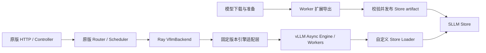

# ServerlessLLM Baseline 的 vLLM 接入与升级完整方案

## Goal

将独立 ServerlessLLM（SLLM）Baseline 的 vLLM 路线从旧接口升级到已有实测依据的
现代引擎，完成模型准备、Store 装载、请求服务、原版迁移路径和资源生命周期的
集成与验收。保持原版 SLLM 的系统方案、调度策略及已支持的外部行为。

本文是待审阅的目标设计，不代表升级已实现或实机资格已通过。允许更新 SLLM
整体依赖；不以保留旧 Python/Ray 环境为设计约束。实现发生在独立 SLLM 工程，
不向 CrossPool runtime 引入 Store、Ray 或 vLLM，也不改变 CrossPool 引擎支持边界。
本设计保存于用户 Fork，不发布到金山团队文档。

### 原有功能与规范不退化：硬性验收条件

用户明确要求：vLLM 引擎升级不能影响原有 ServerlessLLM 项目的功能和规范。
这不是可选取舍。依赖和引擎内部接口可以适配，但不能以升级为由删减原有功能、
改变外部请求/响应和配置语义、替换调度目标，或绕开 Store、迁移及资源生命周期规范。
涉及共享 Router、Scheduler 或 Store 的改动，也必须验证受影响的既有路径；
仅证明新版 vLLM 的限定用例通过，不能推导整个原项目无回归。

按固定上游基点的项目规范、对外承诺、代码和测试建立逐项兼容映射，区分原本支持、
原版本已知缺陷及升级引入的回归。升级回归必须修复；继承缺陷不能被冒认为已有能力，
也不能成为降低项目既定功能要求的理由。规范与实现不一致时，应提交具体证据和
保持功能契约的兼容修复方案，而不是让负责人选择删除功能或放宽验收。

阶段性限定验证用于逐步积累证据，不缩减最终交付范围。尚未通过的原有功能保持
未完成状态；不得仅将其标为 unsupported/unverified 后宣称整个升级已经完成。
续写兼容提案的具体实现仍须审查，本约束不代表批准该实现或授予新 GPU 使用权限。

2026-10-23 的[原版功能核查](original-function-audit.md)确认：项目文档有零停机迁移
与目标请求恢复的功能意图，官方示例采用 Transformers；固定旧 vLLM 则缺少接续方法。
[修订兼容方案](migration-continuation-proposal.md)保留 Transformers 原协议，为 vLLM
提出内部适配，并将 Store CLI、旧参数、调试视图和共享依赖回归一并列为兼容关卡。
这些是待审查的修复目标，不是已经完成的兼容性声明。

本设计拥有独立 SLLM-vLLM 升级；不修改 CrossPool 的生产支持边界。
共同评测遵循本文末尾的“共同评测接口摘要”，不得将历史 Transformers 结果当作
旧 vLLM 回归数据。本任务明确推进 vLLM，不以保持旧环境或改用其他引擎为目标。

本文覆盖从 Fork 建立到版本交付的全过程；[仓库建立操作指南](repository-bootstrap.md)
给出账号核对、Fork、clone、remote、固定基点与分支建立的具体步骤。所有创建、
推送和合并命令均为后续执行说明，写出本方案不等于已经执行。

## 仓库、代码与文档归属

### Fork 的建立与分支结构

在用户选择的个人账号下 Fork 官方
[ServerlessLLM/ServerlessLLM](https://github.com/ServerlessLLM/ServerlessLLM)，
默认沿用仓库名 `ServerlessLLM`。若希望团队共同管理，可选择具有创建权限的
组织账号；实际 owner 和 Fork URL 在执行时确定，不根据本机用户名推断。
优先复用该 owner 已有且确属此上游的 Fork，不重复建立空仓库，不在 CrossPool
仓库内复制一份 SLLM 源码。Fork 保留官方 LICENSE、NOTICE 及版权头。

| Git 对象 | 作用与约束 |
| --- | --- |
| `origin` | 用户/组织的 Fork，正式代码提交与 PR 的目标 |
| `upstream` | 官方 ServerlessLLM，只用于获取来源和对照 |
| Fork 原有默认分支 | 保留官方同步用途，不直接堆叠升级修改 |
| `codex/baseline-vllm` | 从固定参照提交建立的 Baseline 集成分支；验收通过的改动合入此分支 |
| `codex/vllm-upgrade` | 从集成分支建立的升级工作分支，提交环境、Store、后端及测试改动 |
| `sllm-baseline-upstream-9f50241` tag | 指向原始参照提交，不能被移动到含补丁的状态 |
| `sllm-vllm-0.31.0-rc.1` / `sllm-vllm-0.31.0-baseline.1` tag | 分别标记候选与通过声明范围验收的交付；不能在测试前预先标正式版 |

集成分支起点固定为 `9f50241baa5386e06a9321c51f19a9ef5f964c2b`，而不是
Fork 当日的默认分支 HEAD。首个升级 PR 的 base 明确指定 `codex/baseline-vllm`，
head 为 `codex/vllm-upgrade`，均位于自己的 Fork；不向官方仓库自动提 PR。
后续上游同步作为单独改动审查，不在升级过程中自动 rebase 到浮动上游。

新建一个与 CrossPool、既有准备目录并列的独立本地 checkout，目录名建议
`ServerlessLLM-baseline`。Linux 实验服务器从 Fork 的确定 commit/tag 获取代码，
不再以临时脚本目录作为正式部署来源。无法直接联网时传输 Git bundle 或确定
提交的源码包并校验 SHA256；补丁、未提交修改和临时 PYTHONPATH 必须显式记录。

### 正式 Fork 中应保存的内容

以下是新增内容的目标布局，现有上游模块保留原位置。实施时先读取 Fork 自身
AGENTS、代码风格和测试约定，不把 CrossPool 专用运行配置照搬进 SLLM。

```text
ServerlessLLM/
  sllm/                           后端、配置适配、下载器与生命周期改造
  sllm_store/                     Store loader/导出集成、writer 与原生绑定
  tests/                         按上游约定增加契约、集成与 E2E 测试
  configs/baseline/               不含凭据的冻结部署与模型配置
  docs/baseline/
    README.md                    安装、支持范围、运行及退出方式
    engine-upgrade.md            迁入 Fork 后的权威升级设计
    compatibility-matrix.md      已验证组合、限制与原版遗留问题
    provenance.json              上游基点、采用补丁及引擎/依赖来源
    evidence-index.json          外部原始结果位置、摘要、证据范围
  uv.lock                        与实际项目依赖声明配套的 Linux 依赖锁
```

部署镜像及安装脚本复用上游现有入口做最小改造；只有在原布局确实无法承载时
新增入口。代码中使用固定版本适配层，不将研究脚本里的绝对路径、模型名称和
`rank_0` 写死。轻量测试 fixture 可入 Git；模型权重、Store 二进制、wheelhouse、
虚拟环境、大体量日志/压缩包和实验结果保存在外部，由证据索引引用。账号密码、
SSH 私钥与访问 token 通过本机/服务器配置提供，不进入代码或 provenance。

SLLM 专属设计由本文件拥有，工程入口见同目录 README；CrossPool 本地计划
保留跨项目链接及原始来源。共同评测不要求共享运行依赖；个人记录与大型原始
证据留在外部，通过 evidence-index.json 的归档身份核对。本次不发布金山团队文档。

### 仓库建立的离开条件

Fork 的实际 owner/URL 和官方 parent 已核验；本地 `origin/upstream` 正确；固定
参照提交可解析；集成/工作分支及原始 tag 指向正确；正式目录为空的新建 clone
或已审计的合适 checkout；首个 PR 目标明确。仅点击 Fork 或创建一个空文件夹
不算完成工程建立。若账号尚未登录或组织权限不足，只需在执行时补齐该账号条件，
不会以要求用户预先创建空仓库作为技术前提。

## 历史成果迁入与来源审计

现有准备目录、`upstream` checkout、candidate02、引擎选型研究副本和证据包均
保留，不重命名、覆盖、删除或直接改其 remote。先只读检查 `.git`、HEAD、
工作树差异和补丁摘要，形成下表，再向新工作分支迁入最小改动。

| 来源 | 用途 | 迁入规则 |
| --- | --- | --- |
| 固定官方源码 | 原版行为与升级前对照 | 作为 Git 祖先，不以复制源码压平历史 |
| candidate02 累计补丁 | 历史稳定修复线索 | 逐文件说明采用/不采用原因；Transformers 专用修复不伪称 vLLM 必需补丁 |
| vLLM 研究插件和 backend 修复 | Counter/task、Worker 导出、buffer 恢复等实现起点 | 去除临时路径与实验控制逻辑，补充错误/并发/多 rank 契约后再纳入 |
| CPU 参考 Store writer | 原生 writer 正确性 oracle | 保留测试用途，不替代原生快速路径验收 |
| GPU 原始证据 | 证明有限模型/配置可行 | 引用归档摘要和明确范围，不能作为正式集成版本的验收结果 |
| 准备/部署脚本 | 离线依赖、模型下载和服务操作参考 | 只迁入可复现部分；账号、主机目录、分配卡号均配置化 |

`provenance.json` 至少记录上游 URL/commit、历史补丁 SHA256、研究来源摘要、
采纳改动与对应提交、依赖锁摘要、模型 artifact 身份。未验证部分如实记为未验证。
第一阶段必须产出原版行为矩阵，区分“上游实际已支持”“原版缺陷”“新版回归”，
不通过整理补丁偷偷改变 Baseline 的定义。

## Baseline 与已有证据

### 来源与环境

- 原版行为参照 SLLM 提交 `9f50241baa5386e06a9321c51f19a9ef5f964c2b`；旧 vLLM
  0.11.2 路线作为升级前接口参照。历史 candidate02 补丁不能不加区分地全部搬入
  vLLM：逐项审计，保留仍适用的修复，排除 Transformers 专用或临时实验改动。
- 新版起点固定为已测 vLLM **0.31.0**，不跟随浮动 latest。研究实测环境为
  Python 3.12、Torch 2.13.0+cu130、Transformers 5.17.0；这是候选组合的证据，
  不是完整 SLLM 新环境已准入的声明。
- 实施前用 `uv` 锁定完整 Linux 依赖，包括 Ray、Store Python 包及原生构建依赖，
  保存 wheel/镜像摘要、编译器和驱动要求。重新编译 Store 扩展；不得复用旧
  cp310 扩展或仅靠修改版本字符串解决 ABI。依赖解析和无 GPU 导入先完成，
  涉及 CUDA 初始化的检查留到获批实验。
- 不要求和 CrossPool 共用环境。SLLM 的 Torch CUDA 13.0 实测不自动证明
  CrossPool CUDA 13.2 工具链已满足，也不证明旧 V100 可以运行新版 SLLM 候选。

### 可采用与不可外推的实测结论

2026-10-16 的 A100 40GB 研究提供以下有限证据：

| 层次 | 已有证据 | 仍需完成 |
| --- | --- | --- |
| Qwen3-0.6B | BF16、TP1、eager、短 raw prompt；新版 vLLM 原生加载与 Store 恢复的输出 token 和记录 logprobs 相同 | 自动流水线、服务全链、多请求、图和多卡 |
| Qwen3.5-9B | 文本请求的原生/Store 对照，四组短输入各自引擎内 token 与 top5 logprobs 一致 | 不能外推至多模态、长上下文、其他模型或 TP |
| 真实 vLLM backend 对象 | 普通生成、活动 token 跟踪、stop 排空、shutdown 活动请求 abort | Controller/Ray/HTTP、并发竞态、异常启动和重启 |
| Store | Worker 扩展导出及持久 buffer 绑定修复可用 | 原生 writer 曾产出截断文件；后续使用 CPU 参考 writer，原生 writer 尚未修复 |
| 恢复与清理 | 固定原始 prompt 的恢复调用返回；进程组退出后最终显存归零 | 不是源请求快照迁移，也不证明 KV 命中；API 返回时仍有约 416MiB 上下文，不能认定 API 已充分释放 |

原型采用 Worker 扩展及字符串 collective RPC，未修改 vLLM 上游模型执行源码。
插件仍触及 `model_runner.model` 等内部对象，必须收敛到固定版本适配模块。
不能把这些结果用于速度排名、工期倍数或全 Model List 支持声明。

证据包身份（SHA256，供后续归档及复核，不要求工程师访问特定主机路径）：

| 归档 | SHA256 | 关键记录 |
| --- | --- | --- |
| `first-gpu-evidence.zip` | `70067c023a09e4fdadcf24d6976bfe8b7274c0432505201514f89a3cf998e3e2` | `VERIFIED-GPU-SUMMARY.json` |
| `qwen35-evidence.zip` | `7239109b6d36e5b6a7b5a272b19dd39684b1fcf0547c97f9172e7709d6936126` | `QWEN35-GPU-STAGES.json` |
| `backend-contract-gpu-evidence.zip` | `e6689f1e80bc364860b1461d3e606f8ee43c7945babd2131c61197692b4f14bb` | `BACKEND-CONTRACT-VERIFIED.json` |

## 方案选择与行为边界

| 接法 | 取舍 | 本设计选择 |
| --- | --- | --- |
| 更新 SLLM 整体依赖，Ray backend 内使用新版异步引擎及其原生子进程 | 复用控制面及请求调用链；需回归 Ray/Store/ABI | 默认方案 |
| 旧 host 与新版引擎分环境，通过额外服务桥接 | 增加通信、部署和关闭责任；当前无保留旧环境的要求 | 不作为默认实现 |
| 将独立 `vllm serve` 当 HTTP 黑盒 | 普通生成容易，但原有 token 跟踪、恢复和排空接口不能直接保留 | 不采用 |

“整体依赖升级”不意味着把所有组件放进单个进程：保持 SLLM 原有 Ray actor 边界，
vLLM 仍管理其 EngineCore/Worker 子进程。默认先验证同节点的 multiprocessing
执行器，避免嵌套 Ray GPU 调度；TP rank 全部绑定该 backend 实际分配到的设备。
不能用额外进程绕过 Ray 配额。若该执行器无法满足原版某个已支持拓扑，将其记为
兼容阻断并评审修订，不静默更换系统架构。

必须保留模型注册/删除、存储感知放置、按需加载、扩缩容、路由、请求计数及原有
迁移开关的配置含义。模型加载仍经 SLLM Store；不能用原生 HF 加载绕过 Store
来宣称接入完成。默认值必须显式冻结，防止新版引擎默认开启能力而改变实验设置。

升级中不自动改变 messages 到 prompt 的原版规则，不静默加入 chat template、
thinking 或采样默认值。原版简易拼接规则即使不理想，也须先建立兼容用例；
共同性能评测可在驱动侧冻结渲染后的文本/token IDs，另验两侧实际输入一致。
HTTP 仍按原版非流式行为验收；真实流式观测作为后续独立扩展，不能阻塞普通服务
兼容，也不能以完整响应延迟填充 TTFT。

## 目标结构与改造范围



以下路径指独立 SLLM 工程，不是 CrossPool 中拟新增的生产模块。

| 模块 | 目标改造 |
| --- | --- |
| `sllm/backends/vllm_backend.py` | 保留 SllmBackend 方法与响应协议；替换失效导入、配置与关闭入口；补齐并发及异常清理 |
| 新增后端版本适配模块 | 集中管理新版 async engine、task/runner 映射、generate/encode 输出、abort、shutdown；不散布版本分支 |
| `sllm/model_downloader.py` | 用 Worker 扩展替代旧 `save_serverless_llm_state` 内部入口，接回下载、导出、校验、注册 |
| Store-vLLM 集成插件 | 注册 `serverless_llm` loader；恢复 parameter、persistent buffer 与共享 storage；暴露导出 Worker 方法 |
| `sllm_store` 原生 writer 与绑定 | 修复产物完整性，重建原生扩展，核验 IPC/资源所有权 |
| `inference_instance.py`、StoreManager、依赖及镜像 | 只做新环境和子进程生命周期必需的兼容调整；不修改调度策略 |
| Router/Scheduler | 优先仅增加回归覆盖；如发现原版 vLLM 路径缺口，记录独立缺陷并按下述迁移边界处理 |

### 引擎及配置适配

保留 `backend="vllm"`、模型名和 `load_format="serverless_llm"` 的外部含义。
`torch_dtype` 显式映射到新版 dtype；`task="auto"` 不再无条件传给已移除该参数的
构造器。非默认 task 按旧用途映射至新版生成/池化配置并分别验收，不静默回退。
移除 `vllm.utils.Counter` 依赖，以标准计数器生成实例内不冲突的 ID。

配置先分类为 SLLM 自有字段、已映射引擎字段和无支持字段。旧环境曾生效的字段
必须有映射或明确兼容阻断；拼错/失效字段给出可定位错误，不继续静默过滤。
固定 TP、dtype、上下文、KV 预算、prefix cache、eager/graph、batch 限额和采样配置。
未知版本拒绝启动，不能按结构猜测继续运行。

插件通过发行包 entry point 注册，所有 vLLM 子进程可发现，重复注册安全。
Worker 导出使用已命名的方法与字符串 collective RPC，不启用 pickle 回调回退。
精确内部访问点与所依赖版本集中成兼容清单；先做接口探测，再启动大模型。

### 自动准备、导出与 Store 恢复

目标流水线：冻结源 snapshot → 原生新版 vLLM 构造/装载 → 各 TP rank 导出 →
完整性校验 → 独立 Store 恢复核验 → 原子发布 → StoreManager 注册。
首次转换本身可能启动 GPU Worker，必须单独纳入 GPU 申请，不能当作纯下载操作。

每个 rank 从实际模型对象导出完整逻辑状态，使用其真实 TP rank，禁止沿用原型
硬编码 `rank_0`。保存 rank/world size、shape、stride、dtype、文件 offset/字节数、
tensor 摘要和 alias/shared-storage 关系。持久 buffer 与 parameter 同等处理；
非持久 buffer 按模型初始化约定重建并核验设备与 dtype，不能全量转成 BF16。
MoE、量化和混合精度模型按实际执行布局验收，不能把 HF state_dict 名称相同
当作布局兼容。加载后保留引擎需要的权重处理及模型初始化步骤。

Loader 使用 Store 分配/恢复的权重绑定目标对象，避免源 GPU 权重与目标权重完整
共存。原型 CPU 构造再替换 tensor 只作为证据起点，正式路径须报告 CPU 与逐卡
瞬时加载容量；在模型构造不支持无权重骨架时明确准入限制，不强行通用 meta 化。
缺 key、多余 key、非法 alias、dtype/shape/TP 不匹配、越界或截断均启动失败。

导出写入独立临时目录，各 rank 成功后统一校验并在同一文件系统原子发布。
`目录已存在` 不再等于准备完成；只复用身份匹配且有完整提交标记的 artifact。
失败只清理本次临时产物，不删既有有效模型；Store 注册晚于完整提交。
数据格式本身优先保持兼容，增加 sidecar 身份清单；旧 artifact 通过显式校验后
才可复用，不能猜测新版兼容或覆盖旧目录。TP/引擎布局变化要求重新导出。

原生 writer 的截断问题是正式 Store 快速保存路径的发布阻断项。CPU 参考 writer
用于定位和正确性对照；如临时用于候选转换，清单记录 writer 身份、转换成本与
适用范围，不将其结果报告为原版导出性能或完整原生 writer 验收。

### 请求状态与关闭责任

保留现有 `UNINITIALIZED → RUNNING → STOPPING → DELETING` 外部状态含义：

- `init_backend()`：引擎及 Store 恢复成功后才 RUNNING；失败先回收本实例资源，
  再向控制面返回失败，不能暴露半就绪实例。
- `generate(dict)`：保留请求 ID、prompt/input_tokens 优先级、采样、usage、
  finish_reason、错误形式；并发请求隔离。复制入参，避免破坏 Router 保留的数据。
- 活动请求在接纳时、首次引擎输出前即登记，与停机检查在同一同步边界内；
  正常完成、异常、取消均在 finally 中移除活动项。
- `get_current_tokens() -> list[list[int]]`：继续返回每条活动请求的
  prompt IDs + 第一候选已输出 IDs，保持原版接口；记录未产出首 token 的请求，
  不将调试保留的已完成历史当活动项。调试历史和活动集合分开管理。
- `stop()`：原子停止接纳，等待已接纳请求终态，再释放引擎。超时由既有上层
  策略决定；强制关闭须显式标记，不能悄悄把排空变成 abort。
- `shutdown()`：拒绝新请求，abort 活动请求并收集终态，调用新版真实关闭入口，
  等待 Worker/EngineCore 退出。重复调用等待同一关闭任务，不能因状态已置位而
  提前宣称资源释放。异常路径也必须结束本实例拥有的子进程。
- `encode(dict)`：保留原版已支持池化用途的协议，在支持的池化模型上独立回归；
  生成模型不支持 encode 时返回明确错误，不能通过省略此方法完成兼容。

Ray actor 拥有 engine 及其进程树；下载任务拥有转换 Worker；Store 服务拥有其
缓存与 IPC allocation。清理按这些边界进行，不停止其他任务共享的 Store 或 MPS。
不能把 `del engine`、`gc.collect()`、`empty_cache()` 当作进程回收证据。

### 原版迁移机制与兼容缺口

沿用原版 storage-aware scheduler 和 MigrationRouter。其 vLLM 恢复方法
`resume_kv_cache(list[list[int]]) -> None` 对 token 序列调用一次 `max_tokens=1`
生成，目的是重计算/预热目标端前缀。它不是直接传输源 GPU KV，也不提供新的
迁移快照协议；本任务不引入 KV connector 或共享 KV 服务。

源码存在需要明确处理的差异：MigrationRouter 的 `preempted` 分支调用
`resume_generate(request_data, current_output)`；该提交的 Transformers 后端
实现了此分支所需方法，vLLM 后端没有，且 shutdown 返回 abort 而非相同的
preempted 数据。这是原版本身的兼容缺口，不能把“透明续写”当作已存在的
vLLM 行为，再声称新版本只需回归即可获得它。

升级必须执行完整原版 vLLM 迁移调用链：目标加载、活动 token 采集、真实源快照
重放、路由切换、源关闭和资源释放。分别比较迁移期间的请求终态与原版行为。
如果原版仅能 abort 活动请求，新版不能把同样结果描述为透明迁移成功；若该缺口
阻止既定 Baseline 的原版迁移要求，整体验收保持阻断，单列最小兼容修复供审阅。
不能通过关闭迁移、删减回归项或引入另一套迁移算法来解除阻断。

缓存重放验收还须保存实际源 token 序列、目标输入、prefix cache 配置、可用的
命中/复用证据及输出终态。`resume_kv_cache` 返回值不能证明缓存有效；Qwen3.5
混合状态缓存不因短文本生成成功而自动获得迁移资格。跨实例续写若另行补齐，
必须在原有 token 重放机制内明确预算扣减、EOS/stop 和输出拼接，并独立验收。

## Data-Structure Changes

不新增 CrossPool runtime/wire 类型。SLLM 的公共后端方法签名保持不变，新增
内容限定为内部状态与 artifact/验收 sidecar：

| 数据 | 最小内容与约束 |
| --- | --- |
| 内部活动请求记录 | request_id、原始输入 IDs、有效采样参数、最新输出 IDs、是否终态、引擎任务引用；实例拥有，终态统一释放 |
| `artifact-manifest.json` | schema_version、模型 revision、引擎/插件/Store writer 身份、TP world size、逐 rank tensor/文件校验、alias、config/tokenizer 摘要；提交后不可变 |
| artifact 提交标记 | 清单摘要和完成身份；仅在所有 rank/文件校验成功后可见，与原子发布绑定 |
| `compatibility-report.json` | 参照/候选环境、外部方法、输入和响应语义、通过范围、遗留缺陷与升级回归的区分、证据位置 |
| `model-admission.json` | 模型/精度/TP/图/上下文/并发/迁移/encode 分项资格及 failed/unsupported/unverified 原因；不使用一个 supported 布尔覆盖全部能力 |

清单不替代原有 tensor_index 或 Store 传输协议。序列化仅保存可审计的配置与数据，
不保存 Python callable、RequestOutput 实例或不稳定的跨版本对象作为持久恢复格式。

## Implementation 与验证顺序

| 阶段 | 工作与离开条件 | 资源 |
| --- | --- | --- |
| 0：Fork 与工程建立 | 建立/复用用户 Fork、独立 clone、origin/upstream、固定基点/tag 和集成/升级分支；迁入设计与来源索引 | GitHub/本地 CPU；不使用 GPU |
| A：冻结契约和环境 | 原版/补丁差异审计，确定依赖锁与镜像，完成配置映射；CPU 假引擎覆盖请求竞态、状态、导出提交和错误传播 | 本地/CPU；不启动 CUDA |
| B：正式 Store 流水线 | 接回 downloader/Worker 导出、修复 writer、注册 loader；Qwen3-0.6B 原生→Store→独立禁网恢复，各参数/buffer/alias 与生成对照 | 获批后 1 张 A100 40GB |
| C：服务和生命周期 | Controller→Scheduler/Router→Ray backend→Store/vLLM→HTTP 全链；并发、stop/shutdown、重启与故障清理 | 先同一张 A100，串行用例 |
| D：迁移及拓扑 | 原版双实例迁移链、源快照重放/缓存证据、迁移失败回滚；TP2 导出恢复及设备绑定；分别验收，不能互相替代 | 获批后 2 张 A100 40GB，分批执行 |
| E：模型扩展与评测交付 | Qwen3.5-9B 文本范围回归，再逐一扩展 Dense/MoE 等模型；同预算 workload，冻结可报告指标与完整结果包 | 按逐卡容量另申请 |

模型先用 Qwen3-0.6B 降低集成成本，再用已有证据的 Qwen3.5-9B 检查混合状态和
buffer。共同 CrossPool campaign 可另加入 Qwen2.5-0.5B、Qwen3-14B/
30B-A3B、DeepSeek-V2-Lite、GLM-4.7-Flash，逐模型通过双方准入才进共同表。
这与将整个团队 Model List 全部支持是不同交付范围；其余模型逐项保留资格状态。
Falcon-7B/40B 沿用先前决定暂不纳入；不自动新增 DeepSeek-V3、OCR、多模态、
量化、LoRA、EP/PP 或 speculative 的支持承诺，也不删除已有后端能力接口。

### 阶段间的具体交付

所有阶段实行“完成本阶段 → 提交阶段报告 → 等待用户明确审查通过 → 开始下一
阶段”的关卡，包括阶段 0 的 Fork/工程建立、A–E，以及最终 PR 合并与正式版本
交付。阶段 D 的迁移和 TP2 分为两个可单独审查的批次；不得因二者共用 GPU
预算而未经审查连续推进。技术检查通过仅表示具备提交审查的条件，不代表用户
已批准下一阶段。初始完整方案也须由用户明确同意开始实施，不能将修改方案的
请求解释为已授权创建 Fork 或启动阶段 0。

每阶段报告直接在当前聊天中提交，至少包含：

| 报告项 | 必须说明的内容 |
| --- | --- |
| 阶段目标与边界 | 本次批准做什么，实际完成什么，是否满足离开条件 |
| 改动与产物 | Fork/分支/commit、变更文件、配置/依赖和可点击产物位置；未提交改动明确列出 |
| 验证证据 | 执行的检查、实际结果与原始证据；区分通过、失败、跳过及未验证 |
| 问题与方向核对 | 遗留缺陷、风险、与批准方案的偏差及是否影响 Baseline 行为；无偏差也明确说明 |
| 资源与清理 | 本阶段是否用 GPU；如使用，列服务器、逐卡索引、锁模式、实际用量与释放状态 |
| 下一阶段建议 | 拟做事项、范围、预计资源和需要用户决定的问题，结尾明确等待审查 |

提交报告后停止项目推进，不提前编写下一阶段代码、运行验证、创建后续实验、
申请或占用 GPU，也不通过后台任务或其他代理继续。用户提出修改意见时先修正
当前阶段、补齐受影响验证并更新报告，再等待确认；沉默、经过一段时间或此前
笼统的“继续”指令不替代本次关卡的明确通过。发现改变 Baseline 行为、扩大
模型/拓扑范围或修改已批准架构的事项，即使阶段未结束也先报告并等待决定。
故障时先停止本次工作负载并执行必要资源清理，然后提交未通过/中止报告，
不为等到成功而擅自扩大试验或进入后续阶段。

阶段审查和 GPU 审批同时适用。阶段通过不自动授权 GPU；一次 GPU 批次释放后
仍按项目要求等待用户确认，即使该阶段尚未结束。用户可以在同一回复中明确
确认释放并通过阶段审查，但只有同时覆盖两项时才满足两个关卡。阶段报告
默认不发布团队文档；如保存长期实验记录，先遵循研究知识库约定，实际进度和
审查记录不填入本目标设计作为状态日志。

阶段 0 交付实际 Fork/分支地址及基点清单。阶段 A 交付可重建 Linux 环境、
原版行为矩阵、历史改动审计、CPU 测试与 GPU 试验输入包；不在 Windows 上安装
完整 CUDA serving 栈来替代 Linux 验证。Ray 精确版本通过 vLLM/Store 完整环境
解析与控制面回归确定后写入锁文件，不能仅根据旧研究环境猜测兼容。

阶段 B 交付 downloader→逐 rank 导出→校验→Store 恢复的自动路径及 writer
修复；阶段 C 交付真实 HTTP 服务与可证明退出的进程树；阶段 D 分别交付原版
迁移链和 TP2 资格；阶段 E 交付模型矩阵、共同 trace、指标有效性及原始结果索引。
每个阶段的通过仅针对其已运行组合，不提前标记后续阶段通过。

代码按可审阅的依赖层次提交：工程/环境与契约 → writer/loader/导出 → backend
与生命周期 → 控制面全链与迁移 → 模型资格/部署与结果索引。不要求为每个函数
单独建分支；如果拆成多个 PR，后一个明确依赖前一个，避免重复提交同一改动。

### 自动检查与服务器执行

Fork 的默认自动检查只运行无需 GPU 的格式、静态检查、纯 CPU 契约测试及文档
检查；原生 CPU 构建按其环境能力单独配置。GPU 测试不由 push、PR、定时任务
或通用 self-hosted runner 自动触发；依照下节审批后，由受控实验入口执行。
不可隐藏跳过项或把“未分配 GPU 所以 skip”计为实机通过。

每次服务器运行先固定 Git commit、依赖锁和镜像、用例列表、模型 revision、
转换 writer、精度/TP/图模式、缓存前置状态、资源预算和超时；CPU 准备完成
后才申请 GPU。原始结果包含这些身份及实际设备映射，结果不得只绑定分支名。
同一批若发生代码修改，记录新身份并重跑受影响用例，不继续沿用旧报告。

## Validation 与发布条件

1. **环境及接口**：干净环境完整解析依赖、原生 ABI 可加载、插件在所有进程
   可发现；默认/非默认 task、有效配置、非法配置和池化路径都有明确结果。
2. **Store 正确性**：原生 writer 与参考 writer 做完整逻辑 tensor 对照；覆盖
   小/大文件、边界和截断、alias、persistent buffer、混合 dtype、TP 分片及
   转换中断。无缺失/意外 meta tensor；独立进程禁网可恢复，不回源加载权重。
3. **同引擎数值**：新版原生 vs 新版 Store 使用同输入和生效配置；权重逻辑值
   要求一致，确定性短请求比较 token/logprobs，并增加多步固定序列数值检查。
   旧 vs 新内核差异单独诊断，数值容差正式测量前校准冻结，不随结果放宽。
4. **服务契约**：自动注册后真实 HTTP 请求、并发、多模型路由、取消/超时、
   usage/EOS/stop、无输出前 stop、输出异常、初始化失败、重复关闭、actor/Worker
   故障与重启。保证请求计数恢复，无串扰、悬挂或残留调试项阻止排空。
5. **迁移**：真实活动快照及目标重放；原版链路所有环节逐一有证据；检查源/目标
   失败的资源与路由状态。继承缺陷和升级回归分别报告，未通过不能认领完整迁移。
6. **回收**：记录 API 关闭时和 actor/进程树退出后两个边界。所有本次 CUDA 客户端
   已退出，Store allocation 回到试验前基线，Ray 资源归还，私有端口/socket 关闭。
   共享服务或背景占用存在时，比较本次进程与 allocation，不要求全机显存为零。
7. **性能**：正确性后再测相同输入、物理预算、缓存前置状态和到达 trace；启动、
   转换、稳态、迁移分别计时。先对照未修改原版与新版本以识别升级影响，再按共同
   协议比较 CrossPool。无真实流式时 TTFT/TPOT 留空；速度只作研究报告，不预设
   必须更快。三份历史研究包不构成公平性能对照。

最终交付包括可重建依赖和镜像、最小独立 SLLM 补丁/插件、自动模型准备流程、
逐项兼容报告、模型资格矩阵和可复算原始结果。所有正式声明的组合须直接通过
相应门槛；依赖安装、HTTP 返回一句话或后端探针通过均不能替代整体交付。
失败时保留新旧 artifact 与清单，可按完整环境身份回退；不要求旧环境永久在线。

## PR、版本交付与后续维护

工作分支的 PR 向自己 Fork 的 `codex/baseline-vllm` 提交，明确问题、最终行为、
采用的上游/补丁、执行过的验证及未通过项。CPU 通过但 GPU 未完成时只能是
候选 PR/候选版本；原生 writer、原版迁移要求或资源回收仍阻断时，不发布
“完整升级完成”。PR 中的修改清单与最后验证的 Git commit 必须对应。

提交遵循实际工程的 hooks 和代码规范，保留所有已安装 hooks；来源与许可证
可追踪。推送只指向用户 Fork，首次发布分支按该次实施授权范围处理；不强推
既有分支，不向官方推送。合并前审查最终差异和必要验收；如果合并后生成了
不同的可执行代码/依赖身份，重新运行受影响验收，而不是搬用另一棵源码的结果。

通过既定资格后，在 Fork 集成分支标记正式 tag，交付：

| 交付物 | 使用者应能完成的操作 |
| --- | --- |
| Fork URL、集成分支、不可变 tag/commit | 获取同一份升级代码并定位原始上游 |
| Linux 安装/镜像、依赖锁、原生构建说明 | 在新节点重建环境，无需借用研究副本 |
| 样例配置与模型准备入口 | 下载冻结输入，转换并通过 Store 自动注册 |
| 服务运行/停止说明 | 启动全链、运行 smoke、排空或 abort 后验证资源释放 |
| 兼容矩阵、迁移报告和证据索引 | 区分已测模型/精度/TP/图/并发范围及限制 |
| 评测入口与原始结果身份 | 在相同预算下重放 workload 并重算有效指标 |
| 上一有效版本及 artifact 身份 | 失败时选回确定版本，而不是覆盖旧环境或权重 |

后续引擎升级、Ray/Torch/Store ABI 更新、TP 或 writer 布局变化均形成独立 PR，
重跑受影响资格并发布新 tag。配置或权重格式不兼容时明确版本边界，不让旧
artifact 被新 loader 静默解释。正式 tag 不覆盖、不移动。

“完整完成”要求仓库工程化、Store 自动流水线、后端/控制面行为、迁移要求、
回收和声明模型资格全部满足；额外模型和性能研究按矩阵持续扩展，不承诺
未经准入的全部 Model List，也不给出缺少实测依据的总工期。

## GPU 审批与释放

本文只规划，不申请、预留或使用 GPU。阶段资源数量只是预算建议，绝非授权。
每次启动转换、模型导入探针、测试或服务前，按项目规则先暂停并申请，明确：
服务器名、所有实际物理 GPU 索引、锁模式、用途/模型/精度/TP、用例范围和预计时长。
即使只跑一分钟或仅做 GPU 导出，也执行同样审批。

申请报告使用 `服务器 <实际名称>：hard lock GPU <逐项索引>`；采用 soft 时写
`soft lock GPU <逐项索引>`。索引来自拟用节点的真实映射，不能用进程内重编号
代替。先获用户明确批准，再锁定和启动。无可用索引时先做只读资源核查，不能
先占卡再补报；额外卡数、服务器或用途变化重新申请。

建议单卡 smoke 限时 30 分钟、完整服务批次 60 分钟、双卡迁移或 TP 批次各
60 分钟，均先完成 CPU 准备再申请；不得把这些估算当作自动延长授权。
记录单独 watchdog 截止、逐卡显存/主机内存预算，任何失败停止该批 GPU 工作。

每批结束、失败或取消，停止本次工作负载、验证资源回收，然后报告例如
`服务器 <实际名称>：hard unlock GPU <逐项索引>`，附实际使用、结果/失败及
释放证据。若释放失败，如实说明锁仍保留及残留，不伪报 unlock 成功。报告后
暂停，等待用户明确确认，再继续任何后续项目工作；不得后台提前进入下一阶段。

## References

- [固定 SLLM vLLM 后端源码](https://github.com/ServerlessLLM/ServerlessLLM/blob/9f50241baa5386e06a9321c51f19a9ef5f964c2b/sllm/backends/vllm_backend.py)。
- [固定 SLLM MigrationRouter](https://github.com/ServerlessLLM/ServerlessLLM/blob/9f50241baa5386e06a9321c51f19a9ef5f964c2b/sllm/routers/migration_router.py)。
- [固定 SLLM 下载器](https://github.com/ServerlessLLM/ServerlessLLM/blob/9f50241baa5386e06a9321c51f19a9ef5f964c2b/sllm/model_downloader.py)。
- [vLLM 0.31.0 插件机制](https://docs.vllm.ai/en/v0.31.0/design/plugin_system/)，包含 entry point、进程发现及可重入要求。
- [vLLM 0.31.0 model loader](https://docs.vllm.ai/en/v0.31.0/api/vllm/model_executor/model_loader/)。
- [vLLM 0.31.0 Worker 扩展接口](https://docs.vllm.ai/en/v0.31.0/api/vllm/v1/worker/worker_base/)。
## 共同评测接口摘要

本段为不依赖其他本地仓库的实施边界，不能用它扩充模型资格声明：

- 两系统独立部署，在同一硬件预算上交替重放冻结 JSONL trace；每请求固定 ID、
  模型 revision、输入 token IDs、到达偏移、采样/EOS/stop、长度与 timeout。
- 相同 checkpoint、实际权重 dtype、tokenizer 与输入语义；不以不同模型大小或
  输出预算比较速度，不把混合状态/量化/多模态支持从短文本推导出来。
- 服务稳态、模型准备、整体启动与迁移分场景计时；同一客户端单调时钟记录
  send、首输出、末输出及 complete。无真实流式时 token 延迟指标为 null。
- TTFT 为首输出 token 到达减实际发送；TPOT 为首末输出 token 间隔除以 N-1，
  N<=1 为 null。多 token chunk 不均摊成伪 token 时间。
- 保存到达与实际发送差、完整响应/错误、输出数量及指标有效性；报告失败、超时、
  拒绝及 client backpressure，不靠重试或客户端串行化掩盖过载。
- GPU/CPU/内存/存储预算覆盖全服务进程树和 Store；冻结缓存前置状态，不能将
  V100 历史结果与 A100 新结果配成速度比。性能只作研究报告。
- 数值准入先分离“新版原生 vs 新版 Store”的格式正确性和“旧 vs 新”的引擎差异；
  容差在正式测量前冻结，模型资格按 dtype、TP、图、上下文、并发和迁移分别记录。
